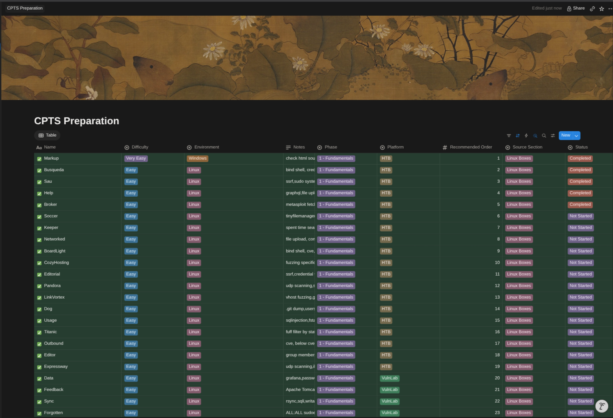
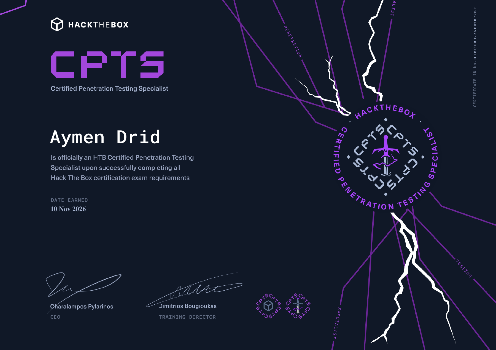

+++
date = '2026-11-10T12:00:00+01:00'
draft = false
title = 'My CPTS Exam Experience'
description = 'How I prepared for CPTS, the rabbit holes I fell into during the exam, and the things I missed while enumerating.'
hideToc = false
tags = ['CPTS', 'Hack The Box', 'Penetration Testing', 'Review', 'Certification']
+++

I'm finally CPTS certified!

## How I prepared

I started preparing in March 2026, around the time of my first [CRTP attempt](/reviews/crtp-review/). I worked on the Active Directory section of the CPTS path, and after my CRTP exam I went back to the path, solving machines alongside it.

I used the [NetSecFocus Trophy Room sheet](https://docs.google.com/spreadsheets/u/1/d/1dwSMIAPIam0PuRBkCiDI88pU3yzrqqHkDtBngUHNCw8/htmlview) as my main preparation reference. This was how I kept track of the machines I was working through:

After working through about 70% of that list, I felt ready and decided to take the exam.

## The exam

I started at 2 p.m. after getting enough sleep. I read the exam letter carefully, then started working on the entry point. Almost immediately, I thought I knew the way forward. Well, that turned out to be a rabbit hole, hehe.

I went through several dead ends because I rushed in without doing my full recon. After a few hours, I finally slowed down and remembered to do the same enumeration I normally do on any machine I solve.

Once I did that, flag 1 came pretty easily. Things went smoothly up to flag 5, but flag 6 kept me stuck for a whole day. That was 24 hours of thinking and enumerating before I finally found a lead. From there, the path to flag 9 was straightforward.

Then I got stuck again. Flag 10 took another day, and the path forward had been right in front of me the whole time. I just hadn't seen it. Once I spotted it, getting to flag 11 was easy.

Flag 12 stopped me again, but this time it was an issue I'd already run into earlier. Once I remembered it, I got moving again.

I lost a lot of time chasing dead ends or missing details during enumeration. Even when I thought I knew where to go, I still needed to slow down and check properly.

And a big thank you to @kanyo for pushing me to take it. Your motivation helped me make that decision, and I really appreciate it.

## The certificate

I earned my HTB Certified Penetration Testing Specialist (CPTS) certification on November 10, 2026.

[View the certificate (PDF)](cpts-certificate.pdf)
